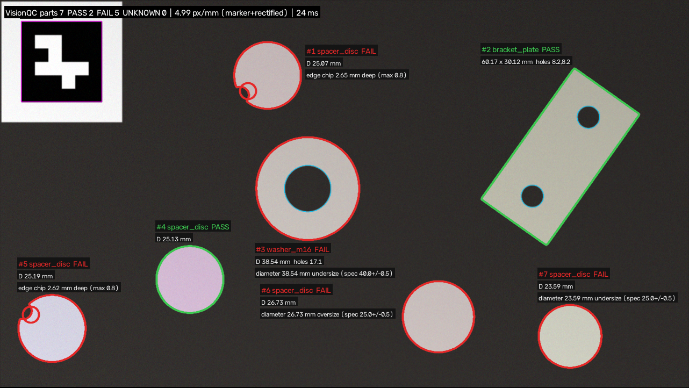

# VisionQC — Automated Optical Inspection & Sub-Pixel Metrology in Python

**VisionQC** is an industrial machine-vision pipeline built with **OpenCV** and **NumPy** for non-contact dimensional gauging and surface/structural defect detection on a conveyor line.



---

## Key Capabilities

1. **Fiducial Scale & Perspective Calibration (`visionqc/calibration.py`)**
   - Detects an **ArUco (`DICT_4X4_50`)** reference marker with sub-pixel corner refinement (`CORNER_REFINE_SUBPIX`).
   - Computes metric scale (`px/mm`) and estimates a **planar homography** to warp tilted camera frames into a fronto-parallel top-down working plane before measurement.
   - Holds calibration state across frames during live video feeds if an operator's hand briefly occludes the marker.

2. **Illumination-Invariant Segmentation (`visionqc/vision.py`)**
   - Gaussian pre-filtering + Otsu thresholding computed strictly over valid (non-padded) image regions, with automatic foreground/background polarity inference and elliptical morphological opening/closing.
   - Extracts two-level contour hierarchies (`RETR_CCOMP`) to associate outer part boundaries with internal bores/holes, automatically flagging parts clipped by the camera frame as `PARTIAL`.

3. **Sub-Pixel Geometric Metrology (`visionqc/vision.py`)**
   - Compensates for the systematic **0.5 px quantization bias** inherent to discrete pixel-center contours (`cv2.findContours`).
   - **Circular features & bores:** Iterative **Kåsa least-squares circle fitting** with outlier rejection (`>1.5 px` residual cutoff) so edge chips do not bias diameter measurements.
   - **Rectangular plates:** Per-edge **Huber M-estimator line fitting (`cv2.fitLine`)** with corner-margin exclusion.
   - **Edge chips & burrs:** Localized via **convex-hull convexity defects (`cv2.convexityDefects`)** measured in millimetres.

4. **YAML-Driven Part Catalogue & Tolerance Engine (`config/parts.yaml`, `visionqc/rules.py`)**
   - New SKUs (`washer_m16`, `bracket_plate`, `spacer_disc`) and tolerances (`tol_mm`, hole counts, `max_chip_depth_mm`) are configured purely in YAML without modifying code.

---

## Benchmark Results (280 Parts across 40 Synthetic Conveyor Scenes)

Evaluated under uneven directional lighting, Gaussian sensor noise ($\sigma = 4$), optical blur, and perspective camera tilt:

| Metric | Flat Camera (`tilt=0.0`) | Tilted Camera (`tilt=0.08`) |
| :--- | :---: | :---: |
| **Part Detection Rate** | **100.0%** (0 false positives) | **100.0%** (0 false positives) |
| **Part Classification Accuracy** | **100.0%** | **100.0%** |
| **PASS / FAIL Decision Accuracy** | **100.0%** | **99.3%** |
| **Defect Recall** *(chip, missing hole, bad bore, over/undersize)* | **100.0%** | **100.0%** |
| **Outer Diameter MAE** | **0.096 mm** (~0.48 px) | **0.139 mm** |
| **Hole Diameter MAE** | **0.095 mm** (~0.47 px) | **0.102 mm** |
| **Mean Frame Latency (1280×720)** | **20.1 ms (~50 FPS)** | **21.7 ms (~46 FPS)** |

---

## Quickstart

```bash
# 1. Install dependencies
pip install -r requirements.txt

# 2. Generate synthetic conveyor test scenes (with ground-truth JSON)
python -m visionqc generate --out samples --n 6

# 3. Run batch inspection (outputs annotated PNGs + results/report.csv)
python -m visionqc inspect samples --out results

# 4. Run quantitative accuracy & latency benchmark
python -m visionqc benchmark --scenes 40 --tilt 0.08

# 5. Deploy the interactive web dashboard & API on Vercel
#    Import this GitHub repo at vercel.com/new (zero-config: serves index.html + /api/inspect)

# 6. Run live webcam inspection locally (print marker.png first via `python -m visionqc marker`)
python -m visionqc live --camera 0
```

## Running Tests

```bash
pytest -q
```
